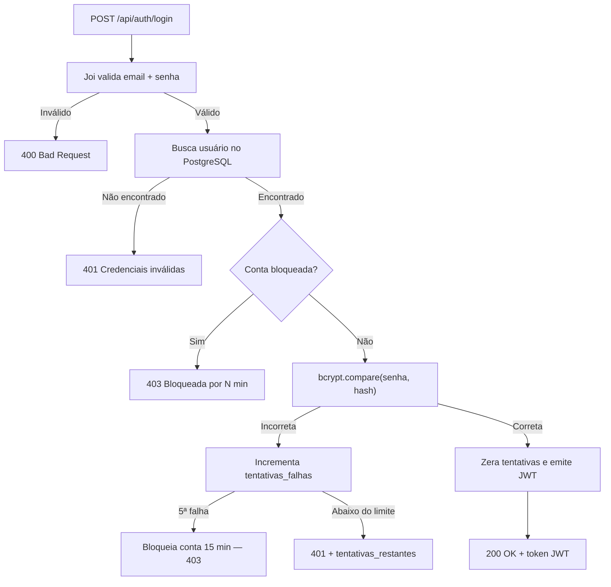
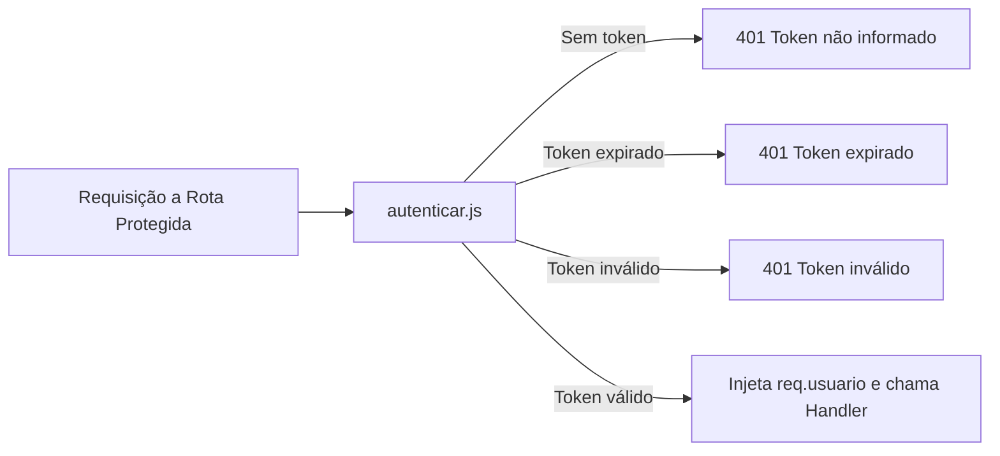
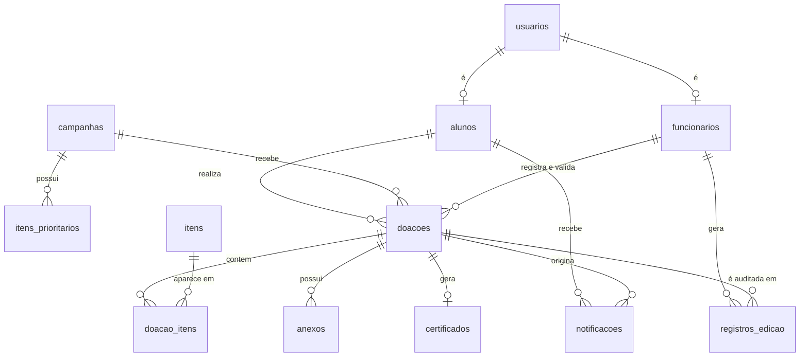

# 🤝 Sistema de Gestão de Doações FMP — Back-end (API + PostgreSQL + Segurança)

**Projeto Integrador** com API REST em **Node.js**, **Express** e **PostgreSQL**, desenvolvida para intermediar a arrecadação de donativos e o controle de horas complementares no sistema da Faculdade Municipal de Palhoça (FMP).

> **Etapa atual:** API com conexão ativa ao PostgreSQL, CRUD de doações, rotas modulares e **camada de segurança completa** (autenticação JWT, hash de senha com bcrypt, validação de dados com Joi e bloqueio progressivo de login).

---

## 📑 Sumário

- [Sobre o projeto](#-sobre-o-projeto)
- [Integrantes do grupo](#-integrantes-do-grupo)
- [O que mudou (Aula 12)](#-o-que-mudou-aula-12)
- [Tecnologias utilizadas](#-tecnologias-utilizadas)
- [Estrutura do projeto](#-estrutura-do-projeto)
- [Segurança & Autenticação](#-segurança--autenticação)
- [Endpoints](#-endpoints)
- [Como executar o projeto](#-como-executar-o-projeto)
- [Banco de Dados](#-banco-de-dados)
- [Testes no Postman](#-testes-no-postman)

---

## 📌 Sobre o projeto

O **Sistema de Gestão de Doações FMP** gerencia a arrecadação de donativos (alimentos, agasalhos, materiais escolares, sangue e eletrônicos) promovidos pela comissão responsável (COPER) e por campanhas institucionais. O back-end fornece toda a infraestrutura necessária para cadastro de usuários, autenticação segura, registro de doações e validação de horas complementares.

---

## 👥 Integrantes do grupo

| Integrante |
|---|
| Davi Aravechia |
| Eduardo Silva |
| Lucas Alexandre Vieira Schutz |
| Vitor |

---

## 🔄 O que mudou (Aula 12)

| Recurso | Versão Anterior | Versão Atual (v2.0) |
|---|---|---|
| **Autenticação** | Sem autenticação (rotas abertas) | **JWT (JSON Web Token)** com expiração via `.env` |
| **Senhas** | Texto plano no banco | Hash seguro com **bcrypt** (Salt rounds = 10) |
| **Validação** | Manual básica dentro das rotas | Centralizada com **Joi** e mensagens personalizadas em PT-BR |
| **Segurança em Login** | Sem restrições | **Bloqueio temporário** após 5 tentativas incorretas (15 min) |
| **Registro de Aluno** | Inserção simples | **Transação atômica (`BEGIN`/`COMMIT`)** entre `usuarios` e `alunos` |
| **Arquitetura** | Monolítica no `server.js` | Modular em `routes/`, `middlewares/` e `schemas/` |
| **Persistência** | Array em memória | **PostgreSQL** com pool de conexões (`pg`) |

### Histórico de versões

| Versão | Destaques |
|---|---|
| **v1** | Rotas básicas GET/POST, sem validação |
| **v2** | CRUD completo, middleware de log e validação, Nodemon, `.env` |
| **v2.0 (atual)** | Conexão real ao PostgreSQL, JWT, bcrypt, Joi, rotas modulares |

---

## 🧰 Tecnologias utilizadas

| Tecnologia | Função no projeto |
|---|---|
| **Node.js** | Ambiente de execução JavaScript no back-end |
| **Express** (v5) | Servidor HTTP e roteamento |
| **PostgreSQL** & **`pg`** | Banco de dados relacional e driver Pool |
| **bcrypt** | Criptografia de senhas (hash unidirecional) |
| **jsonwebtoken (JWT)** | Emissão e verificação de tokens de acesso |
| **Joi** | Validação de schemas e sanitização do corpo das requisições |
| **dotenv** | Gerenciamento de variáveis de ambiente |
| **Nodemon** | Reinício automático do servidor em desenvolvimento |
| **pgAdmin 4** | Execução e teste do script SQL |
| **Postman** | Testes manuais das rotas |

---

## 📁 Estrutura do projeto

```text
aulaoito/
├── middlewares/
│   ├── autenticar.js    ← Validação de token JWT em rotas protegidas
│   └── validar.js       ← Middleware genérico para validações Joi
├── routes/
│   ├── auth.js          ← Rotas públicas: /api/auth/registrar e /login
│   └── doacoes.js       ← CRUD /api/doacoes (protegido por JWT)
├── schemas/
│   └── index.js         ← Schemas Joi centralizados e mensagens de erro PT-BR
├── db.js                ← Pool de conexão com o PostgreSQL
├── server.js            ← Ponto de entrada refatorado da aplicação
├── .env.example         ← Template de variáveis de ambiente
├── .env                 ← Variáveis locais (NÃO vai ao GitHub)
└── .gitignore           ← node_modules/ · .env · *.log
```

---

## 🛡️ Segurança & Autenticação

### Fluxo de Login com Bloqueio Progressivo



### Proteção de Rotas via JWT



### Detalhes de cada camada

| Arquivo | Biblioteca | Responsabilidade |
|---|---|---|
| `schemas/index.js` | **Joi** | Define as regras de cada campo (`registroSchema`, `loginSchema`, `doacaoSchema`, `doacaoUpdateSchema`) com mensagens em PT-BR |
| `middlewares/validar.js` | **Joi** | Factory de middleware: recebe um schema, valida `req.body` e substitui pelos dados normalizados |
| `middlewares/autenticar.js` | **jsonwebtoken** | Lê `Authorization: Bearer <token>`, verifica com `jwt.verify()` e popula `req.usuario` |
| `routes/auth.js` | **bcrypt + jwt** | Registro com hash (`bcrypt.hash`), login com comparação (`bcrypt.compare`) e emissão do token |
| `routes/doacoes.js` | — | CRUD completo, todas as rotas protegidas por `autenticar` |

---

## 🔌 Endpoints

### Públicos (Sem autenticação)

| Método | Rota | Descrição | Status |
|---|---|---|---|
| `GET` | `/` | Health-check da API | `200` |
| `POST` | `/api/auth/registrar` | Cadastra novo usuário + aluno em transação atômica | `201` / `400` / `409` |
| `POST` | `/api/auth/login` | Autentica o usuário e devolve o JWT | `200` / `400` / `401` / `403` |

### Protegidos — Exigem cabeçalho `Authorization: Bearer <token>`

| Método | Rota | Descrição | Status |
|---|---|---|---|
| `GET` | `/api/doacoes` | Lista todas as doações gravadas no banco | `200` / `401` |
| `GET` | `/api/doacoes/:id` | Busca uma doação específica por ID | `200` / `401` / `404` |
| `POST` | `/api/doacoes` | Cadastra uma nova doação no banco | `201` / `400` / `401` |
| `PUT` | `/api/doacoes/:id` | Atualiza status / local / horas de uma doação | `200` / `400` / `401` / `404` |
| `DELETE` | `/api/doacoes/:id` | Remove uma doação pelo ID | `200` / `401` / `404` |

### Exemplos de corpo da requisição

**`POST /api/auth/registrar`**
```json
{
  "nome": "Ana Costa",
  "email": "ana@aluno.fmpsc.edu.br",
  "senha": "segura123",
  "cpf": "123.456.789-00"
}
```

**`POST /api/auth/login`** → retorna `token`
```json
{ "email": "ana@aluno.fmpsc.edu.br", "senha": "segura123" }
```

**`POST /api/doacoes`** (com `Authorization: Bearer <token>`)
```json
{
  "aluno_id": 2,
  "campanha_id": 1,
  "data": "2026-11-03",
  "status": "Pendente",
  "local_entrega": "Recepção Principal FMP"
}
```

---

## 🚀 Como executar o projeto

### Pré-requisitos

- [Node.js](https://nodejs.org/) **18 ou superior**
- PostgreSQL com o banco criado (execute o script SQL abaixo)
- Git

### 1. Clonar o repositório

```bash
git clone https://github.com/DaviAravechiaFMP/sistemaDeDoacoesBack.git
cd sistemaDeDoacoesBack
```

### 2. Instalar as dependências

```bash
npm install
```

### 3. Configurar as variáveis de ambiente

Copie `.env.example` para `.env` e preencha com suas credenciais:

```bash
cp .env.example .env
```

```env
DB_HOST=localhost
DB_PORT=5432
DB_USER=postgres
DB_PASSWORD=sua_senha_aqui
DB_NAME=sistema_doacoes

PORT=3000

JWT_SECRET=chave_super_secreta_fmp_2026
JWT_EXPIRES_IN=8h
```

> O `.env` está no `.gitignore` e **nunca deve ser enviado ao GitHub**.

### 4. Executar o servidor

**Desenvolvimento** (Nodemon — reinicia ao salvar):

```bash
npm run dev
```

**Produção** (Node puro):

```bash
npm start
```

Mensagem esperada no terminal:

```text
✔  Conexão com PostgreSQL estabelecida.
✔  Servidor rodando em http://localhost:3000
```

### Scripts disponíveis

| Comando | O que faz |
|---|---|
| `npm start` | Executa `node server.js` |
| `npm run dev` | Executa `nodemon server.js` |

---

## 🗄️ Banco de Dados

O banco foi modelado com **12 tabelas**. O script completo está em [`Criacao_banco_postgres_projeto_integrador.sql`](Criacao_banco_postgres_projeto_integrador.sql).

### Como executar o script no pgAdmin

1. Instale o **PostgreSQL** e o **pgAdmin 4**.
2. Crie um banco de dados (ex.: `sistema_doacoes`).
3. Abra o **Query Tool**, cole o script e execute (`F5`).

> ⚠️ O script usa `DROP TABLE IF EXISTS CASCADE` — **apaga e recria** todas as tabelas.

### Garantir campos de segurança na tabela `usuarios`

Se você já tem o banco criado sem os campos de bloqueio, rode:

```sql
ALTER TABLE usuarios ADD COLUMN IF NOT EXISTS tentativas_falhas INT DEFAULT 0;
ALTER TABLE usuarios ADD COLUMN IF NOT EXISTS bloqueado_ate TIMESTAMP;
```

### Diagrama de entidades e relacionamentos



### Tabelas

| Tabela | Função |
|---|---|
| `usuarios` | Dados de login e identificação (base para alunos e funcionários) |
| `alunos` | Especialização de `usuarios`: matrícula, curso e saldo de horas |
| `funcionarios` | Especialização de `usuarios`: departamento e cargo |
| `campanhas` | Campanhas de arrecadação, regras de conversão e limite de horas |
| `itens_prioritarios` | Necessidades específicas de cada campanha |
| `doacoes` | Registro de cada doação, com status, horas concedidas e responsáveis |
| `itens` | Catálogo de itens que podem ser doados |
| `doacao_itens` | Tabela de junção **N:N** entre `doacoes` e `itens` (com `quantidade`) |
| `anexos` | Comprovantes de cada doação |
| `certificados` | Certificado emitido para cada doação aprovada |
| `notificacoes` | Avisos enviados aos alunos |
| `registros_edicao` | Auditoria das alterações feitas por funcionários |

---

## 📊 Testes no Postman

Configure o corpo das requisições `POST` e `PUT` como **Body → raw → JSON**.

| # | Método | URL | Body / Header | Resposta esperada |
|---|---|---|---|---|
| 1 | `POST` | `/api/auth/registrar` | `{"nome":"Ana","email":"ana@aluno.fmpsc.edu.br","senha":"abc123"}` | `201` + usuário criado |
| 2 | `POST` | `/api/auth/login` | `{"email":"ana@aluno.fmpsc.edu.br","senha":"abc123"}` | `200` + `token` |
| 3 | `POST` | `/api/auth/login` | senha errada 5× | `403` conta bloqueada |
| 4 | `GET` | `/api/doacoes` | `Authorization: Bearer <token>` | `200` + lista |
| 5 | `GET` | `/api/doacoes` | Sem token | `401` |
| 6 | `POST` | `/api/doacoes` | Token válido + body da doação | `201` |
| 7 | `PUT` | `/api/doacoes/1` | Token válido + `{"status":"Aprovada"}` | `200` |
| 8 | `DELETE` | `/api/doacoes/1` | Token válido | `200` |

> Use o token retornado no login e cole no cabeçalho `Authorization` como `Bearer <token>`.

---

## 📝 Checklist do projeto

- [x] Estrutura Node.js / Express
- [x] Variáveis de ambiente com `.env` e `dotenv`
- [x] `.gitignore` protegendo `.env`, `node_modules/` e `*.log`
- [x] Conexão com PostgreSQL via pool (`pg`)
- [x] CRUD completo de doações
- [x] Middleware de log de requisições
- [x] Validação com **Joi** (schemas centralizados, mensagens PT-BR)
- [x] Hash de senha com **bcrypt** (salt rounds = 10)
- [x] Autenticação com **JWT** (expiração via `.env`)
- [x] Bloqueio temporário após 5 tentativas falhas de login
- [x] Transação atômica no registro de novo usuário
- [x] Rotas modulares (`routes/`) e middlewares separados
- [x] Modelagem do banco (12 tabelas, DDL/DML, diagrama ER)
- [x] Documentação no README

---

## 📄 Observação

Projeto acadêmico desenvolvido para o **Projeto Integrador** da **Faculdade Municipal de Palhoça (FMP)**.
