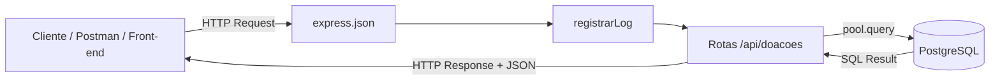
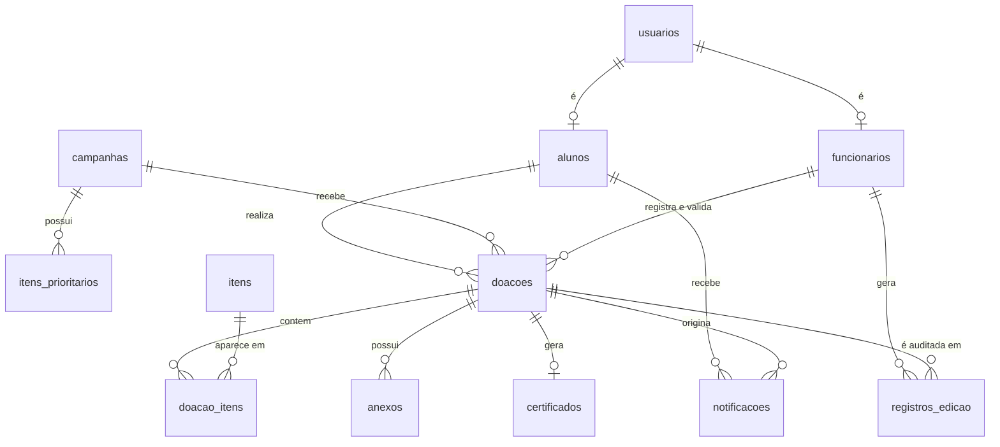

# 🤝 Sistema de Gestão de Doações FMP — Back-end (API v3 + PostgreSQL)

**Projeto Integrador** com API REST desenvolvida em **Node.js** e **Express**, integrada diretamente ao banco de dados relacional **PostgreSQL**, responsável por fornecer e receber os dados do sistema de gestão de doações criado pelo grupo.

> **Etapa atual:** API com CRUD completo conectado ao PostgreSQL com persistência real dos dados (Desafio Prático - Aula 11).

---

## 📑 Sumário

- [Sobre o projeto](#-sobre-o-projeto)
- [Integrantes do grupo](#-integrantes-do-grupo)
- [O que mudou](#-o-que-mudou)
- [Tecnologias utilizadas](#-tecnologias-utilizadas)
- [Arquitetura](#-arquitetura)
- [Como executar a API](#-como-executar-a-api)
- [Estrutura do projeto](#-estrutura-do-projeto)
- [Endpoints](#-endpoints)
- [Middlewares](#-middlewares)
- [Testes no Postman](#-testes-no-postman)
- [Banco de dados (PostgreSQL)](#-banco-de-dados-postgresql)
- [Próximos passos](#-próximos-passos)

---

## 📌 Sobre o projeto

O **Sistema de Gestão de Doações FMP** intermedeia a arrecadação de donativos (alimentos, agasalhos, materiais escolares, sangue e eletrônicos) organizada pela comissão responsável (COPER) e por campanhas institucionais. O sistema cobre o fluxo completo: cadastro de campanhas, registro das doações feitas pelos alunos, validação por funcionários, anexação de comprovantes, geração de certificados e concessão de **horas complementares**.

Esta etapa oferece:

- Rota de verificação da conexão com o banco;
- CRUD completo de doações (listar todas com `JOIN`, buscar por ID, cadastrar, atualizar e remover);
- Persistência real dos dados integrada ao **PostgreSQL** via driver `pg` (Pool de conexões);
- Middlewares globais de **log** de requisições no terminal;
- Respostas padronizadas em JSON com status codes apropriados (`200`, `201`, `400`, `404`, `500`);
- Credenciais sensíveis protegidas via variáveis de ambiente no `.env`;
- Ambiente de desenvolvimento com reinício automático (Nodemon).

---

## 👥 Integrantes do grupo

| Integrante |
|---|
| Davi Aravechia |
| Eduardo Silva |
| Lucas Alexandre Vieira Schutz |
| Vitor |

---

## 🔄 O que mudou

### Da v2 (Memória) para a v3 (PostgreSQL Real)

| Item | Versão Anterior (v2) | Versão Atual (v3 - Aula 11) |
|---|---|---|
| Persistência | Array temporário em memória | **PostgreSQL** com persistência real dos dados |
| Driver de Banco | — | Driver oficial **`pg`** (`Pool` de conexões via `db.js`) |
| Configuração `.env` | Apenas `PORT` | `PORT`, `DB_HOST`, `DB_PORT`, `DB_USER`, `DB_PASSWORD` e `DB_NAME` |
| Rotas `GET` | Leitura de array local | `SELECT` SQL com `JOIN` trazendo dados de alunos, usuários e campanhas |
| Rota `POST` | `push` no array | `INSERT INTO doacoes (...) RETURNING *` |
| Rota `PUT` | Alteração de objeto local | `UPDATE doacoes SET ... RETURNING *` com `COALESCE` |
| Rota `DELETE` | `filter` no array | `DELETE FROM doacoes WHERE id = $1` |
| Tratamento de erros | Básico | Blocos `try/catch` com código `500 Internal Server Error` |

---

## 🧰 Tecnologias utilizadas

| Tecnologia | Função no projeto |
|---|---|
| **Node.js** | Execução do código JavaScript no servidor |
| **Express** (v5) | Criação do servidor HTTP e rotas REST |
| **pg (node-postgres)** | Driver de conexão e execução de queries SQL no PostgreSQL |
| **Dotenv** | Gerenciamento de variáveis de ambiente e credenciais sensíveis |
| **Nodemon** | Auto-reload do servidor em ambiente de desenvolvimento |
| **PostgreSQL** | Banco de dados relacional principal |
| **pgAdmin 4** | Interface para gerenciamento e execução dos scripts DDL/DML |
| **Git / GitHub** | Controle de versão e colaboração do grupo |
| **Postman** | Validação e testes de integração dos endpoints HTTP |

---

## 🏗️ Arquitetura

A aplicação segue a arquitetura cliente-servidor integrada ao SGBD PostgreSQL:



### Fluxo de uma requisição

1. O cliente envia uma requisição HTTP para um endpoint.
2. `express.json()` converte o corpo da requisição em objeto JavaScript (`req.body`).
3. `registrarLog` imprime no terminal o horário, o método e a URL.
4. Em **POST** e **PUT**, `validarDoacao` confere os dados enviados. Se algo estiver errado, responde `400` e a rota nem é executada.
5. A rota consulta ou altera o array em memória.
6. O servidor devolve o status code correto e o JSON de resposta.

### Verbos HTTP utilizados

| Verbo | Uso geral | Uso nesta API |
|---|---|---|
| `GET` | Consultar dados | Listar todas as doações e buscar uma por ID |
| `POST` | Criar dados | Cadastrar nova doação |
| `PUT` | Atualizar dados | Atualizar uma doação existente |
| `DELETE` | Remover dados | Remover uma doação pelo ID |

---

## 🚀 Como executar a API

### Pré-requisitos

- [Node.js](https://nodejs.org/) **18 ou superior**
- NPM (já vem com o Node.js)
- Git

### 1. Clonar o repositório

```bash
git clone https://github.com/DaviAravechiaFMP/sistemaDeDoacoesBack.git
cd sistemaDeDoacoesBack
```

### 2. Criar o arquivo `.env`

Na raiz do projeto, crie um arquivo chamado `.env` com:

```env
PORT=3000
```

> O `.env` está no `.gitignore` e **não deve ser enviado ao GitHub**. Se `PORT` não for definida, a API usa `3000` por padrão.

### 3. Instalar as dependências

```bash
npm install
```

### 4. Iniciar o servidor

**Desenvolvimento** (com Nodemon, reinicia ao salvar):

```bash
npm run dev
```

**Produção** (Node puro):

```bash
npm start
```

Mensagem esperada no terminal:

```text
Servidor rodando na porta 3000
```

A API ficará disponível em: **http://localhost:3000**

### Scripts disponíveis

| Comando | O que faz |
|---|---|
| `npm start` | Executa `node server.js` |
| `npm run dev` | Executa `nodemon server.js` |

---

## 📁 Estrutura do projeto

```text
sistemaDeDoacoesBack/
├── database/
│   └── script.sql    <- Script PostgreSQL (DDL + DML + consultas JOIN)
├── docs/
│   └── diagrama.png  <- Diagrama do banco de dados
├── node_modules/
├── .env              <- Variáveis de ambiente (local, não vai ao GitHub)
├── .gitignore        <- Protege .env e node_modules
├── package.json      <- Scripts start/dev e dependências
├── package-lock.json
├── README.md         <- Documentação do projeto
└── server.js         <- Servidor Express, middlewares e rotas
```

> Ajuste os nomes de pasta/arquivo acima se no repositório estiverem diferentes.

---

## 🔌 Endpoints

### Visão geral

| Método | Endpoint | Descrição | Status possíveis |
|---|---|---|---|
| `GET` | `/` | Verifica se a API está no ar | `200` |
| `GET` | `/api/doacoes` | Lista todas as doações | `200` |
| `GET` | `/api/doacoes/:id` | Busca uma doação pelo ID | `200` / `404` |
| `POST` | `/api/doacoes` | Cadastra uma nova doação | `201` / `400` |
| `PUT` | `/api/doacoes/:id` | Atualiza uma doação existente | `200` / `400` / `404` |
| `DELETE` | `/api/doacoes/:id` | Remove uma doação | `200` / `404` |

### Modelo de dados da API (em memória)

| Campo | Tipo | Descrição |
|---|---|---|
| `id` | Número | Gerado automaticamente pela API |
| `doador` | Texto | Nome de quem doou |
| `item` | Texto | O que foi doado |
| `quantidade` | Número | Quantidade doada (maior que 0) |
| `status` | Texto | `"pendente"` ao cadastrar (a API não altera esse campo no `PUT`) |

Dados iniciais carregados ao subir o servidor:

```json
[
  { "id": 1, "doador": "Maria Silva", "item": "Cesta básica", "quantidade": 2, "status": "recebida" },
  { "id": 2, "doador": "João Souza", "item": "Cobertor", "quantidade": 5, "status": "pendente" }
]
```

---

### 1. `GET /`

Verifica se a API está ativa.

**200 OK**

```json
{ "mensagem": "API do Sistema de Doações funcionando" }
```

### 2. `GET /api/doacoes`

Retorna todas as doações armazenadas.

**200 OK**

```json
[
  { "id": 1, "doador": "Maria Silva", "item": "Cesta básica", "quantidade": 2, "status": "recebida" },
  { "id": 2, "doador": "João Souza", "item": "Cobertor", "quantidade": 5, "status": "pendente" }
]
```

### 3. `GET /api/doacoes/:id`

Busca uma doação pelo ID (parâmetro de rota).

**200 OK**

```json
{ "id": 1, "doador": "Maria Silva", "item": "Cesta básica", "quantidade": 2, "status": "recebida" }
```

**404 Not Found**

```json
{ "mensagem": "Doação não encontrada" }
```

### 4. `POST /api/doacoes`

Cadastra uma nova doação. O `id` é o **maior ID existente + 1** e o `status` inicial é `"pendente"`.

**Corpo da requisição (JSON)**

| Campo | Tipo | Obrigatório | Regra |
|---|---|---|---|
| `doador` | Texto | Sim | Não pode ser vazio |
| `item` | Texto | Sim | Não pode ser vazio |
| `quantidade` | Número | Sim | Deve ser do tipo número e maior que 0 |

```json
{ "doador": "Ana Costa", "item": "Agasalho", "quantidade": 3 }
```

**201 Created**

```json
{ "id": 3, "doador": "Ana Costa", "item": "Agasalho", "quantidade": 3, "status": "pendente" }
```

**400 Bad Request** (exemplo)

```json
{ "mensagem": "A quantidade deve ser um número maior que 0" }
```

### 5. `PUT /api/doacoes/:id`

Atualiza `doador`, `item` e `quantidade` de uma doação existente. Usa as mesmas regras de validação do `POST`.

**Corpo da requisição (JSON)**

```json
{ "doador": "Maria Silva", "item": "Cesta básica completa", "quantidade": 4 }
```

**200 OK**

```json
{ "id": 1, "doador": "Maria Silva", "item": "Cesta básica completa", "quantidade": 4, "status": "recebida" }
```

**400 Bad Request**: corpo inválido (mesmas mensagens do `POST`).

**404 Not Found**

```json
{ "mensagem": "Doação não encontrada" }
```

### 6. `DELETE /api/doacoes/:id`

Remove uma doação pelo ID.

**200 OK**

```json
{ "mensagem": "Doação removida com sucesso" }
```

**404 Not Found**

```json
{ "mensagem": "Doação não encontrada" }
```

### Rotas inexistentes

Qualquer rota que não exista retorna:

**404 Not Found**

```json
{ "mensagem": "Rota não encontrada" }
```

### Mensagens de erro de validação (400)

| Situação | Mensagem retornada |
|---|---|
| Corpo da requisição ausente | `O corpo da requisição não pode estar vazio` |
| `doador` ausente ou vazio | `O doador é obrigatório` |
| `item` ausente ou vazio | `O item é obrigatório` |
| `quantidade` ausente, não numérica ou ≤ 0 | `A quantidade deve ser um número maior que 0` |

---

## 🛡️ Middlewares

| Middleware | Escopo | Função |
|---|---|---|
| `express.json()` | Global | Converte o corpo da requisição em JSON (sem ele, `req.body` fica `undefined`) |
| `registrarLog` | Global | Imprime no terminal horário, método HTTP e URL de cada requisição |
| `validarDoacao` | `POST` e `PUT` | Garante que `doador`, `item` e `quantidade` (número > 0) foram enviados corretamente |
| Fallback 404 | Final | Captura qualquer rota inexistente e responde `404` em JSON |

Exemplo de saída do log no terminal:

```text
[14:32:10] GET /api/doacoes
[14:32:25] POST /api/doacoes
```

> **Ordem importa:** os middlewares são registrados **antes** das rotas, e o fallback `404` fica **por último**. Todo middleware chama `next()` para liberar a requisição.

---

## 📊 Testes no Postman

Configure o corpo das requisições `POST` e `PUT` como **Body → raw → JSON**.

| # | Método | URL | Body (JSON) | Resposta esperada |
|---|---|---|---|---|
| 1 | `GET` | `http://localhost:3000/api/doacoes` | — | `200 OK` + lista completa |
| 2 | `GET` | `http://localhost:3000/api/doacoes/1` | — | `200 OK` + doação de id 1 |
| 3 | `GET` | `http://localhost:3000/api/doacoes/999` | — | `404 Not Found` |
| 4 | `POST` | `http://localhost:3000/api/doacoes` | `{"doador":"Ana","item":"Agasalho","quantidade":3}` | `201 Created` + objeto criado |
| 5 | `POST` | `http://localhost:3000/api/doacoes` | `{}` ou sem campo obrigatório | `400 Bad Request` (middleware) |
| 6 | `PUT` | `http://localhost:3000/api/doacoes/1` | `{"doador":"Maria","item":"Cesta Padrão","quantidade":5}` | `200 OK` + objeto atualizado |
| 7 | `DELETE` | `http://localhost:3000/api/doacoes/1` | — | `200 OK` + mensagem de remoção |

> O navegador só faz requisições `GET`. Use o Postman para `POST`, `PUT` e `DELETE`, e acompanhe o terminal para ver o middleware de log funcionando.

---

## 🗄️ Banco de dados (PostgreSQL)

O banco foi modelado no **Desafio Técnico - Aula 10** e contém **12 tabelas**. O script completo está em [`database/script.sql`](database/script.sql).

### Diagrama de entidades e relacionamentos



Diagrama físico completo (com colunas e tipos): [`docs/diagrama.png`](docs/diagrama.png).

### Tabelas

| Tabela | Função |
|---|---|
| `usuarios` | Dados de login e identificação (base para alunos e funcionários) |
| `alunos` | Especialização de `usuarios`: matrícula, curso e saldo de horas |
| `funcionarios` | Especialização de `usuarios`: departamento e cargo |
| `campanhas` | Campanhas de arrecadação, regras de conversão em horas e limite de horas |
| `itens_prioritarios` | Necessidades específicas de cada campanha (meta e urgência) |
| `doacoes` | Registro de cada doação, com status, horas concedidas e responsáveis |
| `itens` | Catálogo de itens que podem ser doados |
| `doacao_itens` | Tabela de junção **N:N** entre `doacoes` e `itens` (com `quantidade`) |
| `anexos` | Comprovantes de cada doação |
| `certificados` | Certificado emitido para cada doação aprovada |
| `notificacoes` | Avisos enviados aos alunos |
| `registros_edicao` | Auditoria das alterações feitas por funcionários |

### Relacionamentos

| Tipo | Relacionamentos |
|---|---|
| **1:1** | `usuarios` ↔ `alunos`, `usuarios` ↔ `funcionarios`, `doacoes` ↔ `certificados` |
| **1:N** | `campanhas` → `itens_prioritarios`, `alunos` → `doacoes`, `campanhas` → `doacoes`, `funcionarios` → `doacoes`, `doacoes` → `anexos`, `doacoes` → `notificacoes`, `funcionarios` → `registros_edicao` |
| **N:N** | `doacoes` ↔ `itens` (via `doacao_itens`) |

### Como executar o script no pgAdmin

1. Instale o **PostgreSQL** e o **pgAdmin 4**.
2. No pgAdmin, crie um banco de dados (ex.: `doacoes_fmp`).
3. Clique com o botão direito no banco → **Query Tool**.
4. Abra o arquivo `database/script.sql` (ícone de pasta) e clique em **Executar** (▶ ou `F5`).
5. O script apaga as tabelas antigas (`DROP TABLE IF EXISTS`), cria as 12 tabelas, insere os dados de exemplo e roda as consultas.

> ⚠️ O script **apaga e recria** todas as tabelas. Não execute em um banco que já tenha dados que você quer manter.

### Consultas de exemplo (JOIN)

**Doações com aluno e campanha**

```sql
SELECT d.id AS doacao_id, u.nome AS aluno, a.matricula,
       c.titulo AS campanha, d.data, d.status, d.horas_concedidas
FROM doacoes d
JOIN alunos a ON d.aluno_id = a.id
JOIN usuarios u ON a.id = u.id
JOIN campanhas c ON d.campanha_id = c.id;
```

**Itens de cada doação (relação N:N)**

```sql
SELECT d.id AS doacao_id, u.nome AS doador, c.titulo AS campanha,
       i.nome AS item_doado, i.categoria, di.quantidade
FROM doacoes d
JOIN alunos a ON d.aluno_id = a.id
JOIN usuarios u ON a.id = u.id
JOIN campanhas c ON d.campanha_id = c.id
JOIN doacao_itens di ON d.id = di.doacao_id
JOIN itens i ON di.item_id = i.id;
```

### Como a API atual se relaciona com o banco

O modelo da API (em memória) é mais simples que o do banco. Na integração será preciso mapear:

| Campo da API | Onde fica no banco |
|---|---|
| `id` | `doacoes.id` |
| `doador` | `usuarios.nome` (via `doacoes.aluno_id` → `alunos` → `usuarios`) |
| `item` | `itens.nome` (via `doacao_itens`) |
| `quantidade` | `doacao_itens.quantidade` |
| `status` | `doacoes.status` (no banco: `Pendente`, `Aprovada`...) |

---

## ⚠️ Limitações conhecidas

- **API sem banco:** os dados da API vivem em memória e são perdidos ao reiniciar o servidor (inclusive a cada alteração salva no modo `npm run dev`). O PostgreSQL está modelado, mas ainda não conectado.
- **Modelos diferentes:** a API usa `doador`/`item`/`quantidade` em texto livre, enquanto o banco é normalizado (ver tabela de mapeamento acima).
- **Validação antes da busca no `PUT`:** como `validarDoacao` roda antes da rota, um `PUT` com corpo inválido em um ID inexistente retorna `400` (e não `404`).
- **Sem autenticação:** qualquer cliente pode acessar todas as rotas.
- **Sem testes automatizados:** os testes são manuais, via Postman.

---

## 🗺️ Próximos passos

- [ ] Conectar a API ao PostgreSQL (ex.: biblioteca `pg`) usando variáveis no `.env`;
- [ ] Adaptar as rotas para ler e gravar nas tabelas do banco;
- [ ] Reorganizar o código em camadas (rotas, controllers, middlewares);
- [ ] Permitir alterar o `status` da doação;
- [ ] Implementar autenticação (a tabela `usuarios` já prevê senha e bloqueio por tentativas);
- [ ] Conectar a API ao front-end do projeto.

---

## 📝 Status atual

**API v2 concluída + banco de dados PostgreSQL modelado.**

- [x] Estrutura Node.js / Express
- [x] Variáveis de ambiente com `.env` e `dotenv`
- [x] `.gitignore` protegendo `.env` e `node_modules`
- [x] Execução com Nodemon (`npm run dev`)
- [x] Middleware de log
- [x] Middleware de validação (POST e PUT)
- [x] Rotas `GET /`, `GET /api/doacoes` e `GET /api/doacoes/:id`
- [x] Rotas `POST`, `PUT` e `DELETE`
- [x] Tratamento de rotas inexistentes (404)
- [x] Status codes HTTP (200, 201, 400, 404)
- [x] Modelagem do banco (conceitual, lógica e física)
- [x] Script SQL com DDL, DML e consultas JOIN em `database/script.sql`
- [x] Diagrama do banco
- [x] Documentação no README
- [ ] Integração API ↔ PostgreSQL

---

## 📄 Observação

Projeto acadêmico desenvolvido para o **Projeto Integrador** da **Faculdade Municipal de Palhoça (FMP)**.
