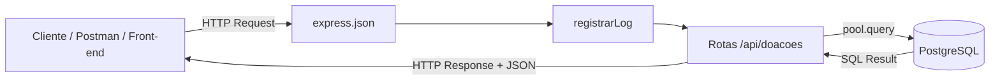
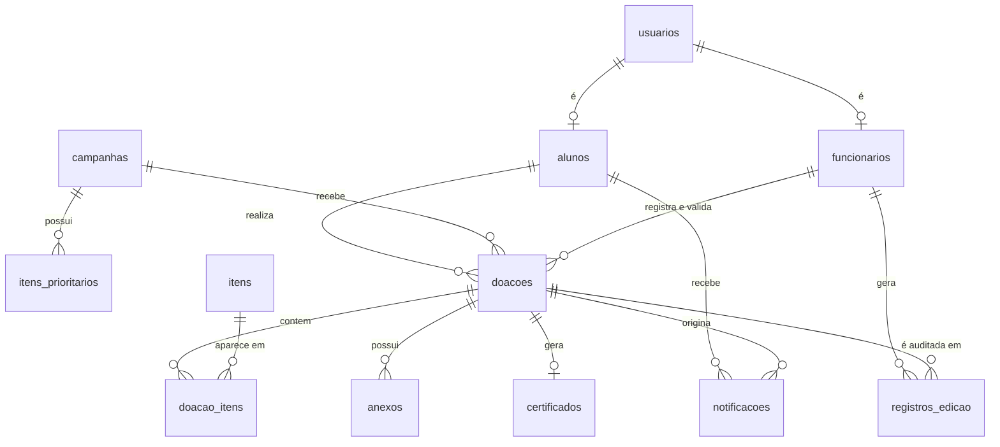

# 🤝 Sistema de Gestão de Doações FMP — Back-end (API v3 + PostgreSQL)

**Projeto Integrador** com API REST desenvolvida em **Node.js** e **Express**, integrada ao banco de dados relacional **PostgreSQL**, responsável por fornecer e receber os dados do sistema de gestão de doações criado pelo grupo.

> **Etapa atual:** CRUD completo conectado ao PostgreSQL com persistência real dos dados (Desafio Prático - Aula 11).

---

## 📑 Sumário

- [Sobre o projeto](#-sobre-o-projeto)
- [Integrantes do grupo](#-integrantes-do-grupo)
- [O que mudou](#-o-que-mudou)
- [Tecnologias utilizadas](#-tecnologias-utilizadas)
- [Arquitetura](#-arquitetura)
- [Como executar a API](#-como-executar-a-api)
- [Configuração do banco de dados](#-configuração-do-banco-de-dados)
- [Estrutura do projeto](#-estrutura-do-projeto)
- [Endpoints](#-endpoints)
- [Testes no Postman](#-testes-no-postman)
- [Prova de persistência](#-prova-de-persistência)
- [Modelagem do banco (PostgreSQL)](#-modelagem-do-banco-postgresql)
- [Checklist do desafio](#-checklist-do-desafio-aula-11)
- [Limitações conhecidas e próximos passos](#-limitações-conhecidas-e-próximos-passos)

---

## 📌 Sobre o projeto

O **Sistema de Gestão de Doações FMP** intermedeia a arrecadação de donativos (alimentos, agasalhos, materiais escolares, sangue e eletrônicos) organizada pela comissão responsável (COPER) e por campanhas institucionais. O sistema cobre o fluxo completo: cadastro de campanhas, registro das doações feitas pelos alunos, validação por funcionários, anexação de comprovantes, geração de certificados e concessão de **horas complementares**.

Esta etapa oferece:

- Conexão com o **PostgreSQL** via driver `pg` (`Pool` de conexões), configurada em arquivo separado (`db.js`);
- Credenciais protegidas por variáveis de ambiente (`.env`) e `.gitignore`;
- CRUD completo de doações: listar todas (com `JOIN`), buscar por ID, cadastrar, atualizar e remover;
- **Persistência real**: os dados continuam no banco mesmo após reiniciar o servidor;
- Middleware global de **log** de requisições no terminal;
- Respostas em JSON com status codes apropriados (`200`, `201`, `400`, `404`, `500`) e tratamento de erros com `try/catch`;
- Ambiente de desenvolvimento com reinício automático (Nodemon).

---

## 👥 Integrantes do grupo

| Integrante |
|---|
| Davi Aravechia |
| Eduardo Silva |
| Lucas Alexandre Vieira Schutz |
| Vitor |

---

## 🔄 O que mudou

### Da v2 (Memória) para a v3 (PostgreSQL Real)

| Item | Versão Anterior (v2) | Versão Atual (v3 - Aula 11) |
|---|---|---|
| Persistência | Array temporário em memória | **PostgreSQL** com persistência real dos dados |
| Driver de Banco | — | Driver oficial **`pg`** (`Pool` de conexões em `db.js`) |
| Configuração `.env` | Apenas `PORT` | `PORT`, `DB_HOST`, `DB_PORT`, `DB_USER`, `DB_PASSWORD` e `DB_NAME` |
| Rotas `GET` | Leitura de array local | `SELECT` SQL com `JOIN` trazendo dados de alunos, usuários e campanhas |
| Rota `POST` | `push` no array | `INSERT INTO doacoes (...) RETURNING *` |
| Rota `PUT` | Alteração de objeto local | `UPDATE doacoes SET ... RETURNING *` com `COALESCE` |
| Rota `DELETE` | `filter` no array | `DELETE FROM doacoes WHERE id = $1 RETURNING *` |
| Tratamento de erros | Básico | Blocos `try/catch` com código `500 Internal Server Error` |

---

## 🧰 Tecnologias utilizadas

| Tecnologia | Função no projeto |
|---|---|
| **Node.js** | Execução do código JavaScript no servidor |
| **Express** (v5) | Criação do servidor HTTP e rotas REST |
| **pg (node-postgres)** | Driver de conexão e execução de queries SQL no PostgreSQL |
| **Dotenv** | Gerenciamento de variáveis de ambiente e credenciais sensíveis |
| **Nodemon** | Auto-reload do servidor em ambiente de desenvolvimento |
| **PostgreSQL** | Banco de dados relacional principal |
| **pgAdmin 4** | Interface para gerenciamento e execução do script SQL |
| **Git / GitHub** | Controle de versão e colaboração do grupo |
| **Postman** | Validação e testes de integração dos endpoints HTTP |

---

## 🏗️ Arquitetura



### Fluxo de uma requisição

1. O cliente envia uma requisição HTTP para um endpoint.
2. `express.json()` converte o corpo da requisição em objeto JavaScript (`req.body`).
3. `registrarLog` imprime no terminal o horário, o método e a URL.
4. A rota valida os dados recebidos (`req.params` / `req.body`). Se algo estiver errado, responde `400`.
5. A rota executa a query SQL no PostgreSQL com `pool.query`, usando **queries parametrizadas** (`$1, $2...`), o que evita SQL Injection.
6. O servidor devolve o status code correto e o JSON de resposta. Qualquer falha inesperada cai no `catch` e retorna `500`.

### Verbos HTTP utilizados

| Verbo | Operação SQL | Uso nesta API |
|---|---|---|
| `GET` | `SELECT` | Listar todas as doações e buscar uma por ID |
| `POST` | `INSERT` | Cadastrar nova doação |
| `PUT` | `UPDATE` | Atualizar uma doação existente |
| `DELETE` | `DELETE` | Remover uma doação pelo ID |

---

## 🚀 Como executar a API

### Pré-requisitos

- [Node.js](https://nodejs.org/) **18 ou superior**
- NPM (já vem com o Node.js)
- [PostgreSQL](https://www.postgresql.org/) e [pgAdmin 4](https://www.pgadmin.org/)
- Git

### 1. Clonar o repositório

```bash
git clone https://github.com/DaviAravechiaFMP/sistemaDeDoacoesBack.git
cd sistemaDeDoacoesBack
```

### 2. Configurar o banco de dados

Siga a seção [Configuração do banco de dados](#-configuração-do-banco-de-dados) (criar o banco no pgAdmin e executar o script `.sql`).

### 3. Criar o arquivo `.env`

Na raiz do projeto, crie um arquivo chamado `.env` com o conteúdo abaixo (ajuste para a sua máquina):

```env
PORT=3000
DB_HOST=localhost
DB_PORT=5432
DB_USER=postgres
DB_PASSWORD=sua_senha_aqui
DB_NAME=doacoes_fmp
```

| Variável | Descrição |
|---|---|
| `PORT` | Porta em que a API vai rodar (se não for definida, usa `3000`) |
| `DB_HOST` | Endereço do servidor PostgreSQL (`localhost` em ambiente local) |
| `DB_PORT` | Porta do PostgreSQL (padrão `5432`) |
| `DB_USER` | Usuário do PostgreSQL |
| `DB_PASSWORD` | Senha do usuário do PostgreSQL |
| `DB_NAME` | Nome do banco criado no pgAdmin |

> 🔒 O `.env` está no `.gitignore` e **nunca deve ser enviado ao GitHub**, pois contém credenciais.

### 4. Instalar as dependências

```bash
npm install
```

### 5. Iniciar o servidor

**Desenvolvimento** (com Nodemon, reinicia ao salvar):

```bash
npm run dev
```

**Produção** (Node puro):

```bash
npm start
```

Mensagem esperada no terminal:

```text
Servidor rodando na porta 3000
```

A API ficará disponível em: **http://localhost:3000**

### Scripts disponíveis

| Comando | O que faz |
|---|---|
| `npm start` | Executa `node server.js` |
| `npm run dev` | Executa `nodemon server.js` |

---

## 🗄️ Configuração do banco de dados

O script de criação do banco (DDL + dados de teste) é o arquivo [`Criacao_banco_postgres_projeto_integrador.sql`](Criacao_banco_postgres_projeto_integrador.sql), na raiz do repositório.

### Passo a passo no pgAdmin

1. Instale o **PostgreSQL** e o **pgAdmin 4**.
2. No pgAdmin, clique com o botão direito em **Databases → Create → Database** e crie um banco (ex.: `doacoes_fmp`).
3. Clique com o botão direito no banco criado → **Query Tool**.
4. Abra o arquivo `Criacao_banco_postgres_projeto_integrador.sql` (ícone de pasta) e clique em **Executar** (▶ ou `F5`).
5. O script cria as **12 tabelas** (com `PRIMARY KEY`, `FOREIGN KEY` e a tabela de junção N:N `doacao_itens`) e insere os dados de teste (7 usuários, 4 alunos, 3 campanhas, 5 itens e 3 doações).
6. Confira em **Schemas → public → Tables** se as tabelas apareceram.
7. Use o mesmo nome do banco no `.env` (`DB_NAME=doacoes_fmp`).

> ⚠️ O script **apaga e recria** as tabelas (`DROP TABLE IF EXISTS ... CASCADE`). Não execute em um banco que já tenha dados que você quer manter.

### Dados de teste úteis para o `POST`

| Tabela | IDs disponíveis |
|---|---|
| `alunos` | `2` (Davi), `3` (Eduardo), `4` (Lucas Schutz), `5` (Vitor) |
| `campanhas` | `1` (Campanha de Inverno 2026), `2` (SOS Enchentes RS), `3` (Material Escolar Solidário) |

---

## 📁 Estrutura do projeto

```text
sistemaDeDoacoesBack/
├── .env                                          <- Credenciais (local, NÃO vai ao GitHub)
├── .gitignore                                    <- Protege .env e node_modules
├── Criacao_banco_postgres_projeto_integrador.sql <- Script PostgreSQL (DDL + dados de teste)
├── Diagrama projeto integrador.png               <- Diagrama do banco de dados
├── db.js                                         <- Conexão com o PostgreSQL (Pool do pg + dotenv)
├── server.js                                     <- Servidor Express, middlewares e rotas CRUD
├── package.json                                  <- Scripts start/dev e dependências
├── package-lock.json
└── README.md                                     <- Documentação do projeto
```

---

## 🔌 Endpoints

### Tabela de endpoints

| VERBO | URL | AÇÃO |
|---|---|---|
| `GET` | `/` | Verifica se a API está no ar |
| `GET` | `/api/doacoes` | Lista todas as doações (`SELECT` com `JOIN`) |
| `GET` | `/api/doacoes/:id` | Busca uma doação pelo ID (`SELECT ... WHERE id = $1`) |
| `POST` | `/api/doacoes` | Cadastra uma nova doação (`INSERT`) |
| `PUT` | `/api/doacoes/:id` | Atualiza uma doação existente (`UPDATE`) |
| `DELETE` | `/api/doacoes/:id` | Remove uma doação (`DELETE`) |

### Status codes por endpoint

| Endpoint | Status possíveis |
|---|---|
| `GET /` | `200` |
| `GET /api/doacoes` | `200` / `500` |
| `GET /api/doacoes/:id` | `200` / `400` / `404` / `500` |
| `POST /api/doacoes` | `201` / `400` / `500` |
| `PUT /api/doacoes/:id` | `200` / `400` / `404` / `500` |
| `DELETE /api/doacoes/:id` | `200` / `400` / `404` / `500` |

| Código | Significado |
|---|---|
| `200 OK` | Requisição bem-sucedida |
| `201 Created` | Registro criado com sucesso (`POST`) |
| `400 Bad Request` | ID inválido ou campos obrigatórios ausentes |
| `404 Not Found` | Doação (ou rota) não encontrada |
| `500 Internal Server Error` | Erro no banco de dados, tratado com `try/catch` |

---

### 1. `GET /`

Verifica se a API está ativa.

**200 OK**

```json
{ "mensagem": "API do Sistema de Doações funcionando com PostgreSQL!" }
```

### 2. `GET /api/doacoes`

Lista todas as doações do banco, ordenadas por `id`. Usa `JOIN` com `alunos` e `usuarios` (nome do doador) e `LEFT JOIN` com `campanhas`.

**200 OK**

```json
[
  {
    "id": 1,
    "doador": "Davi",
    "campanha": "Campanha de Inverno 2026",
    "status": "Aprovada",
    "data": "2026-06-01T03:00:00.000Z",
    "horas_concedidas": "10.00",
    "local_entrega": "Recepção Principal FMP"
  },
  {
    "id": 2,
    "doador": "Eduardo",
    "campanha": "SOS Enchentes RS",
    "status": "Aprovada",
    "data": "2026-06-20T03:00:00.000Z",
    "horas_concedidas": "20.00",
    "local_entrega": "Hemocentro SC"
  }
]
```

> O exemplo mostra as duas primeiras doações de teste. O formato de `data` pode variar conforme o fuso horário da máquina, e `horas_concedidas` volta como texto porque o tipo `NUMERIC` do PostgreSQL é serializado como *string* pelo driver `pg`.

**500 Internal Server Error**

```json
{ "erro": "Erro ao buscar doações do banco de dados", "detalhe": "mensagem do erro" }
```

### 3. `GET /api/doacoes/:id`

Busca uma doação pelo ID, recebido como parâmetro de rota (`req.params.id`).

**200 OK**

```json
{
  "id": 1,
  "doador": "Davi",
  "campanha": "Campanha de Inverno 2026",
  "status": "Aprovada",
  "data": "2026-06-01T03:00:00.000Z",
  "horas_concedidas": "10.00",
  "local_entrega": "Recepção Principal FMP"
}
```

**400 Bad Request** (ID não numérico, ex.: `/api/doacoes/abc`)

```json
{ "mensagem": "O ID deve ser um número válido" }
```

**404 Not Found**

```json
{ "mensagem": "Doação não encontrada" }
```

### 4. `POST /api/doacoes`

Cadastra uma nova doação com os dados do `req.body`. Executa `INSERT INTO doacoes (...) RETURNING *` e devolve o registro criado, com o `id` gerado pelo banco.

**Corpo da requisição (JSON)**

| Campo | Tipo | Obrigatório | Regra |
|---|---|---|---|
| `aluno_id` | Número | Sim | Deve ser o ID de um aluno existente (FK para `alunos`) |
| `data` | Texto (`AAAA-MM-DD`) | Sim | Data da doação |
| `campanha_id` | Número | Não | ID de uma campanha existente (se omitido, fica `null`) |
| `status` | Texto | Não | Padrão: `"Pendente"` |
| `local_entrega` | Texto | Não | Padrão: `"Recepção Principal FMP"` |

```json
{
  "aluno_id": 2,
  "campanha_id": 1,
  "data": "2026-10-27",
  "status": "Pendente",
  "local_entrega": "Recepção Principal FMP"
}
```

**201 Created**

```json
{
  "id": 4,
  "aluno_id": 2,
  "campanha_id": 1,
  "func_registro_id": null,
  "func_validacao_id": null,
  "data": "2026-10-27T03:00:00.000Z",
  "status": "Pendente",
  "foto_evidencia": null,
  "motivo_reprovacao": null,
  "horas_concedidas": null,
  "horario_doacao": null,
  "retencao_anos": null,
  "local_entrega": "Recepção Principal FMP"
}
```

**400 Bad Request**

```json
{ "mensagem": "Os campos aluno_id e data são obrigatórios" }
```

**500 Internal Server Error**: falha ao gravar no banco (ex.: `aluno_id` ou `campanha_id` inexistente, que viola a chave estrangeira).

### 5. `PUT /api/doacoes/:id`

Atualiza uma doação existente usando o `id` de `req.params` e os dados de `req.body`. Executa `UPDATE ... SET campo = COALESCE($n, campo) ... RETURNING *`: **campos não enviados são mantidos** como estavam.

**Corpo da requisição (JSON)** — todos os campos são opcionais

| Campo | Tipo | Descrição |
|---|---|---|
| `status` | Texto | Ex.: `"Aprovada"`, `"Reprovada"`, `"Pendente"` |
| `local_entrega` | Texto | Local onde a doação foi entregue |
| `horas_concedidas` | Número | Horas complementares concedidas |

```json
{ "status": "Aprovada", "horas_concedidas": 8 }
```

**200 OK**: devolve o registro completo já atualizado.

**400 Bad Request**

```json
{ "mensagem": "O ID deve ser um número válido" }
```

**404 Not Found**

```json
{ "mensagem": "Doação não encontrada" }
```

### 6. `DELETE /api/doacoes/:id`

Remove a doação pelo `id` de `req.params` (`DELETE FROM doacoes WHERE id = $1 RETURNING *`).

**200 OK**

```json
{ "mensagem": "Doação removida com sucesso do banco de dados" }
```

**400 Bad Request**: `{ "mensagem": "O ID deve ser um número válido" }`

**404 Not Found**: `{ "mensagem": "Doação não encontrada" }`

**500 Internal Server Error**: a doação possui registros vinculados que impedem a exclusão (veja [Limitações](#-limitações-conhecidas-e-próximos-passos)).

### Rotas inexistentes

Qualquer rota que não exista retorna **404 Not Found**:

```json
{ "mensagem": "Rota não encontrada" }
```

### Middlewares

| Middleware | Escopo | Função |
|---|---|---|
| `express.json()` | Global | Converte o corpo da requisição em JSON (sem ele, `req.body` fica `undefined`) |
| `registrarLog` | Global | Imprime no terminal horário, método HTTP e URL de cada requisição |
| Fallback 404 | Final | Captura qualquer rota inexistente e responde `404` em JSON |

Exemplo de saída do log no terminal:

```text
[14:32:10] GET /api/doacoes
[14:32:25] POST /api/doacoes
```

> **Ordem importa:** os middlewares são registrados **antes** das rotas, e o fallback `404` fica **por último**.

---

## 📊 Testes no Postman

Configure o corpo das requisições `POST` e `PUT` como **Body → raw → JSON**.

| # | Método | URL | Body (JSON) | Resposta esperada |
|---|---|---|---|---|
| 1 | `GET` | `http://localhost:3000/api/doacoes` | — | `200 OK` + lista das doações vinda do banco |
| 2 | `GET` | `http://localhost:3000/api/doacoes/1` | — | `200 OK` + doação de id 1 |
| 3 | `GET` | `http://localhost:3000/api/doacoes/999` | — | `404 Not Found` |
| 4 | `GET` | `http://localhost:3000/api/doacoes/abc` | — | `400 Bad Request` |
| 5 | `POST` | `http://localhost:3000/api/doacoes` | `{"aluno_id":2,"campanha_id":1,"data":"2026-10-27"}` | `201 Created` + registro criado (conferir no pgAdmin) |
| 6 | `POST` | `http://localhost:3000/api/doacoes` | `{}` | `400 Bad Request` |
| 7 | `PUT` | `http://localhost:3000/api/doacoes/4` | `{"status":"Aprovada","horas_concedidas":8}` | `200 OK` + registro atualizado |
| 8 | `DELETE` | `http://localhost:3000/api/doacoes/4` | — | `200 OK` + mensagem de remoção |

> O navegador só faz requisições `GET`. Use o Postman para `POST`, `PUT` e `DELETE` e acompanhe o terminal para ver o log funcionando.
> Os testes `PUT`/`DELETE` usam o `id 4` (o registro criado no teste 5). Ajuste se o seu `POST` retornar outro `id`.

---

## 💾 Prova de persistência

Regra de ouro do desafio: a API **não usa mais array em memória**. Para comprovar:

1. Faça um `POST /api/doacoes` e anote o `id` retornado.
2. Abra o pgAdmin e consulte a tabela `doacoes` (clique direito → **View/Edit Data → All Rows**): o registro está lá.
3. Pare o servidor (`Ctrl + C`) e inicie novamente com `npm run dev`.
4. Faça um `GET /api/doacoes`: o registro cadastrado **continua aparecendo** no JSON e no pgAdmin.

---

## 🧬 Modelagem do banco (PostgreSQL)

O banco foi modelado no **Desafio Técnico - Aula 10** e contém **12 tabelas**. Script: [`Criacao_banco_postgres_projeto_integrador.sql`](Criacao_banco_postgres_projeto_integrador.sql) — Diagrama: [`Diagrama projeto integrador.png`](Diagrama%20projeto%20integrador.png).



### Tabelas

| Tabela | Função |
|---|---|
| `usuarios` | Dados de login e identificação (base para alunos e funcionários) |
| `alunos` | Especialização de `usuarios`: matrícula, curso e saldo de horas |
| `funcionarios` | Especialização de `usuarios`: departamento e cargo |
| `campanhas` | Campanhas de arrecadação, regras de conversão em horas e limite de horas |
| `itens_prioritarios` | Necessidades específicas de cada campanha (meta e urgência) |
| `doacoes` | Registro de cada doação, com status, horas concedidas e responsáveis |
| `itens` | Catálogo de itens que podem ser doados |
| `doacao_itens` | Tabela de junção **N:N** entre `doacoes` e `itens` (com `quantidade`) |
| `anexos` | Comprovantes de cada doação |
| `certificados` | Certificado emitido para cada doação aprovada |
| `notificacoes` | Avisos enviados aos alunos |
| `registros_edicao` | Auditoria das alterações feitas por funcionários |

### Relacionamentos

| Tipo | Relacionamentos |
|---|---|
| **1:1** | `usuarios` ↔ `alunos`, `usuarios` ↔ `funcionarios`, `doacoes` ↔ `certificados` |
| **1:N** | `campanhas` → `itens_prioritarios`, `alunos` → `doacoes`, `campanhas` → `doacoes`, `funcionarios` → `doacoes`, `doacoes` → `anexos`, `doacoes` → `notificacoes`, `funcionarios` → `registros_edicao` |
| **N:N** | `doacoes` ↔ `itens` (via `doacao_itens`) |

### Consulta usada como base do `GET /api/doacoes`

```sql
SELECT d.id, u.nome AS doador, c.titulo AS campanha,
       d.status, d.data, d.horas_concedidas, d.local_entrega
FROM doacoes d
JOIN alunos a ON d.aluno_id = a.id
JOIN usuarios u ON a.id = u.id
LEFT JOIN campanhas c ON d.campanha_id = c.id
ORDER BY d.id ASC;
```

---

## ✅ Checklist do desafio (Aula 11)

- [x] Banco criado no pgAdmin a partir do script SQL, com PKs, FKs e tabela de junção N:N
- [x] Dados de teste cadastrados (via `INSERT` no script)
- [x] Driver `pg` instalado
- [x] Conexão configurada em arquivo separado (`db.js`)
- [x] Credenciais no `.env` (`DB_HOST`, `DB_PORT`, `DB_USER`, `DB_PASSWORD`, `DB_NAME`)
- [x] `.env` protegido pelo `.gitignore`
- [x] `GET` (listar) e `GET` por id com `req.params`
- [x] `POST` com `INSERT` e `req.body`
- [x] `PUT` com `UPDATE` (`req.body` + `req.params`)
- [x] `DELETE` com `req.params`
- [x] Status codes (200, 201, 400, 404, 500) e `try/catch`
- [x] Sem array em memória: persistência real no PostgreSQL
- [x] README com tabela de endpoints e instruções de banco (`.env` e script `.sql`)

---

## ⚠️ Limitações conhecidas e próximos passos

**Limitações**

- **`DELETE` de doações com registros vinculados:** as doações de teste `1`, `2` e `3` possuem registros em `notificacoes` e `registros_edicao`, cujas chaves estrangeiras não têm `ON DELETE CASCADE`. Excluí-las retorna `500`. Doações criadas pelo `POST` (sem vínculos) são removidas normalmente.
- **IDs inexistentes no `POST`:** enviar um `aluno_id` ou `campanha_id` que não existe retorna `500` (violação de FK), e não `400`.
- **`PUT` sem validação de corpo:** um `PUT` com corpo vazio responde `200` sem alterar nada.
- **API cobre apenas `doacoes`:** as demais tabelas existem no banco, mas ainda não têm rotas.
- **Sem autenticação:** qualquer cliente pode acessar todas as rotas.
- **Sem testes automatizados:** os testes são manuais, via Postman.

**Próximos passos**

- [ ] Reorganizar o código em camadas (rotas, controllers, middlewares);
- [ ] Criar rotas CRUD para alunos, campanhas e itens;
- [ ] Cadastrar os itens de cada doação pela API (`doacao_itens`);
- [ ] Implementar autenticação (a tabela `usuarios` já prevê senha e bloqueio por tentativas);
- [ ] Conectar a API ao front-end do projeto.

---

## 📄 Observação

Projeto acadêmico desenvolvido para o **Projeto Integrador** da **Faculdade Municipal de Palhoça (FMP)**.
