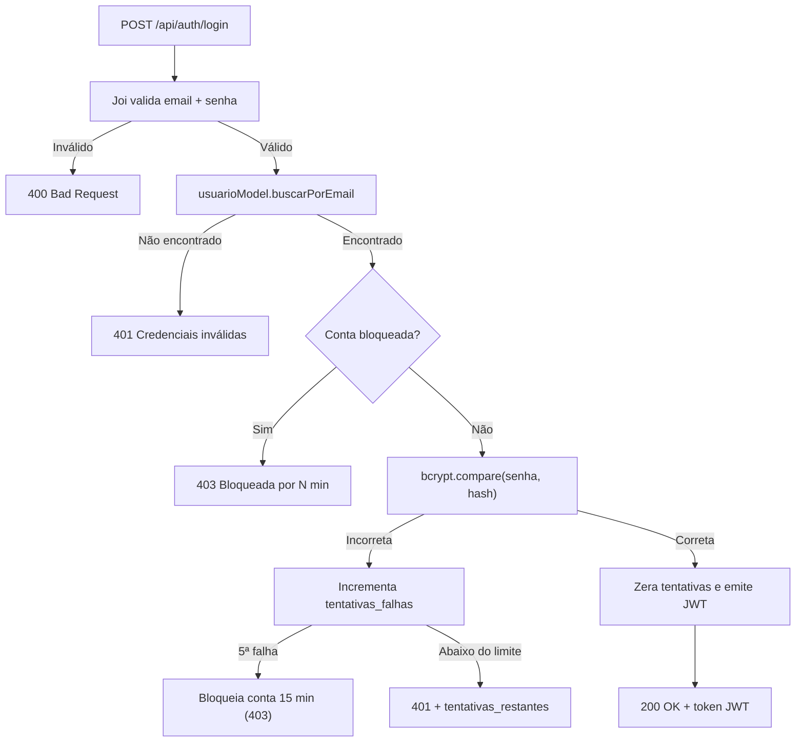
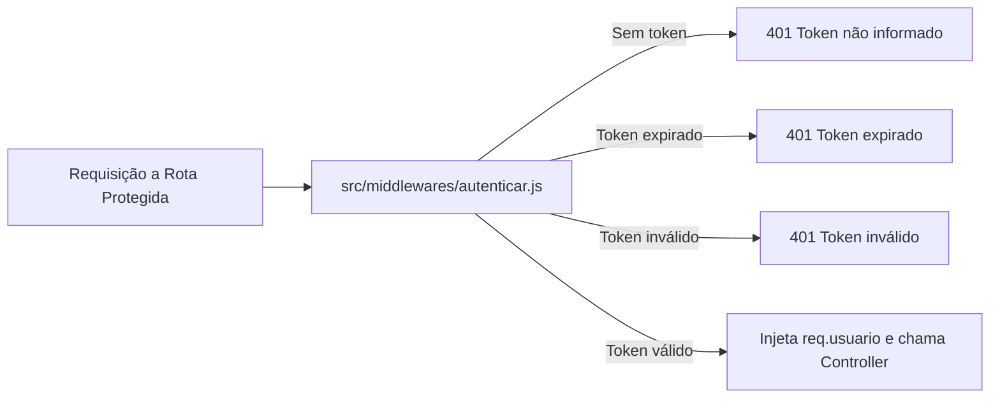
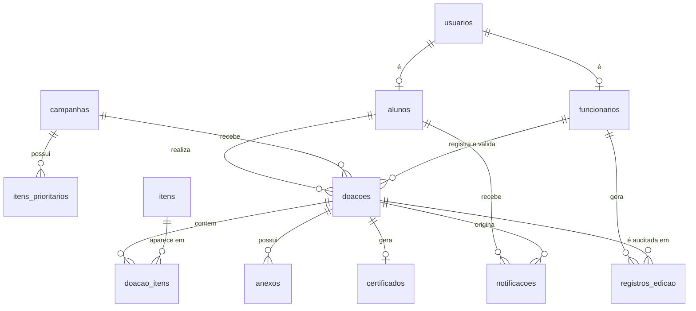

# 🤝 Sistema de Gestão de Doações FMP — Back-end (API + PostgreSQL + Segurança MVC)

**Projeto Integrador** com API REST em **Node.js**, **Express** e **PostgreSQL**, desenvolvida para intermediar a arrecadação de donativos e o controle de horas complementares no sistema da Faculdade Municipal de Palhoça (FMP).

> **Etapa atual (Aula 13):** Arquitetura **MVC completa consolidada em `src/`**, banco de dados PostgreSQL integrado, transações atômicas, rotas protegidas por **JWT**, hash de senha com **bcrypt**, validação de dados com **Joi**, suporte a **CORS**, bloqueio progressivo de login, endpoints de perfil e catálogo de itens, e documentação para deploy na nuvem (**Render**).

---

## 📑 Sumário

- [Sobre o projeto](#-sobre-o-projeto)
- [Integrantes do grupo](#-integrantes-do-grupo)
- [Documentação do Projeto](#-documentação-do-projeto)
- [Tecnologias utilizadas](#-tecnologias-utilizadas)
- [Estrutura do projeto (MVC)](#-estrutura-do-projeto-mvc)
- [Segurança & Autenticação](#-segurança--autenticação)
- [Endpoints da API](#-endpoints-da-api)
- [Como executar o projeto](#-como-executar-o-projeto)
- [Banco de Dados](#-banco-de-dados)
- [Testes com Postman](#-testes-com-postman)
- [Deploy em Produção (Render)](#-deploy-em-produção-render)

---

## 📌 Sobre o projeto

O **Sistema de Gestão de Doações FMP** gerencia a arrecadação de donativos (alimentos, agasalhos, materiais escolares, sangue e eletrônicos) promovidos pela comissão responsável (COPER) e por campanhas institucionais. O back-end fornece toda a infraestrutura necessária para cadastro de usuários, autenticação segura, consulta de perfil do aluno (saldo de horas), registro e gestão de doações, catálogo de itens aceitos e consulta de campanhas vigentes.

---

## 👥 Integrantes do grupo

| Integrante |
|---|
| Davi Aravechia |
| Eduardo Silva |
| Lucas Alexandre Vieira Schutz |

---

## 📚 Documentação do Projeto

Todos os manuais, contratos e artefatos de entrega estão organizados no diretório [`docs/`](docs/):

- 📜 [**Contrato Oficial da API (API_CONTRACT.md)**](docs/API_CONTRACT.md) — Especificação detalhada de todos os endpoints, headers, payload JWT e exemplos exatos de JSON de request e response (sucesso e erros `400`, `401`, `403`, `404`, `409`).
- 💻 [**Guia de Integração com o Front-end (FRONTEND_INTEGRATION_GUIDE.md)**](docs/FRONTEND_INTEGRATION_GUIDE.md) — Guia pronto para IA ou desenvolvedores Front-end (React + Vite) contendo cliente Axios com interceptor de token, `AuthContext`, `PrivateRoute`, perfil do aluno e listagens de doações e itens.
- 🚀 [**Guia de Banco de Dados e Deploy no Render (DATABASE_AND_DEPLOY.md)**](docs/DATABASE_AND_DEPLOY.md) — Passo a passo para provisionamento do PostgreSQL gerenciado e do Web Service Node.js no Render com suporte a SSL e `DATABASE_URL`.
- 🎬 [**Roteiro do Vídeo de Apresentação (ROTEIRO_VIDEO_E_ENTREGA.md)**](docs/ROTEIRO_VIDEO_E_ENTREGA.md) — Roteiro de 4 minutos cronometrado e dividido em 3 partes de 1m20s (Davi, Lucas e Eduardo), com checklist da Aula 13.
- 📮 [**Coleção Postman v2.1**](docs/postman/Sistema_Doacoes_FMP.postman_collection.json) — Arquivo JSON pronto para importar no Postman com todas as requisições configuradas, exemplos de respostas e script para salvar o token JWT automaticamente.

---

## 🧰 Tecnologias utilizadas

| Tecnologia | Função no projeto |
|---|---|
| **Node.js** | Ambiente de execução JavaScript no back-end |
| **Express** (v5) | Servidor HTTP e arquitetura de rotas modulares |
| **PostgreSQL** & **`pg`** | Banco de dados relacional e driver Pool |
| **cors** | Habilitação de requisições cross-origin para o front-end |
| **bcrypt** | Criptografia unidirecional de senhas (salt rounds = 10) |
| **jsonwebtoken (JWT)** | Emissão e verificação de tokens de acesso para rotas protegidas |
| **Joi** | Validação rigorosa de schemas e sanitização dos dados |
| **dotenv** | Carregamento de variáveis de ambiente |
| **Nodemon** | Reinício automático do servidor durante o desenvolvimento |
| **Postman** | Documentação e testes automatizados de endpoints |

---

## 📁 Estrutura do projeto (MVC)

Todo o código-fonte da aplicação está estruturado dentro de `src/`, respeitando a separação de responsabilidades do padrão **MVC**:

```text
aulaoito/
├── docs/
│   ├── postman/
│   │   └── Sistema_Doacoes_FMP.postman_collection.json  ← Coleção v2.1 completa
│   ├── API_CONTRACT.md              ← Contrato e esquemas JSON da API
│   ├── FRONTEND_INTEGRATION_GUIDE.md← Guia para integração em React + Vite
│   ├── DATABASE_AND_DEPLOY.md       ← Guia de deploy no Render (Web Service + DB)
│   └── ROTEIRO_VIDEO_E_ENTREGA.md   ← Roteiro do vídeo da Aula 13 e checklist
├── src/
│   ├── config/
│   │   └── db.js                    ← Pool PostgreSQL com suporte a DATABASE_URL e SSL
│   ├── controllers/
│   │   ├── authController.js        ← Lógica de registro, login e perfil do usuário
│   │   ├── campanhaController.js    ← Controller para listagem de campanhas
│   │   ├── doacaoController.js      ← CRUD de doações e validação de regras
│   │   └── itemController.js        ← Controller para catálogo de itens
│   ├── middlewares/
│   │   ├── autenticar.js            ← Verificação de JWT no cabeçalho Authorization
│   │   └── validar.js               ← Middleware genérico para validação com Joi
│   ├── models/
│   │   ├── campanhaModel.js         ← Queries SQL de campanhas
│   │   ├── doacaoModel.js           ← Queries SQL de doações (JOINs e CRUD)
│   │   ├── itemModel.js             ← Queries SQL de itens de doação
│   │   └── usuarioModel.js          ← Transações atômicas, login e dados de perfil
│   ├── routes/
│   │   ├── authRoutes.js            ← Rotas de auth (registro, login, perfil)
│   │   ├── campanhaRoutes.js        ← Rotas protegidas de campanhas
│   │   ├── doacaoRoutes.js          ← Rotas protegidas de doações
│   │   └── itemRoutes.js            ← Rotas protegidas de catálogo de itens
│   ├── schemas/
│   │   └── index.js                 ← Schemas Joi centralizados e mensagens PT-BR
│   └── app.js                       ← Instância Express, CORS e montagem de rotas
├── Criacao_banco_postgres_projeto_integrador.sql ← DDL, DML e carga inicial do banco
├── Diagrama projeto integrador.png   ← Diagrama relacional das 12 tabelas
├── .env.example                     ← Template de variáveis de ambiente
├── .env                             ← Variáveis locais (protegido no .gitignore)
├── .gitignore                       ← Ignora node_modules, .env e logs
├── package.json                     ← Scripts e dependências do projeto
├── package-lock.json                ← Lockfile de dependências
├── README.md                        ← Documentação principal
└── server.js                        ← Ponto de entrada (Bootstrap e conexão ao banco)
```

---

## 🛡️ Segurança & Autenticação

### Fluxo de Login com Bloqueio Progressivo



### Proteção de Rotas via JWT



---

## 🔌 Endpoints da API

Consulte os exemplos completos de JSON de request e response em [`docs/API_CONTRACT.md`](docs/API_CONTRACT.md).

### Públicos (Sem necessidade de Token)

| Método | Rota | Descrição | Status Codes |
|---|---|---|---|
| `GET` | `/` | Health-check da API e versão | `200` |
| `POST` | `/api/auth/registrar` | Cadastra novo usuário + aluno (transação atômica) | `201`, `400`, `409` |
| `POST` | `/api/auth/login` | Autentica com bcrypt, bloqueio progressivo e emite JWT | `200`, `400`, `401`, `403` |

### Protegidos — Exigem cabeçalho `Authorization: Bearer <token>`

| Método | Rota | Descrição | Status Codes |
|---|---|---|---|
| `GET` | `/api/auth/perfil` | Consulta perfil e saldo de horas do aluno logado | `200`, `401`, `404` |
| `GET` | `/api/doacoes` | Lista doações com dados do doador e da campanha | `200`, `401` |
| `GET` | `/api/doacoes/:id` | Busca uma doação específica pelo ID | `200`, `400`, `401`, `404` |
| `POST` | `/api/doacoes` | Registra uma nova doação (validada por Joi) | `201`, `400`, `401` |
| `PUT` | `/api/doacoes/:id` | Atualiza status/local/horas de uma doação | `200`, `400`, `401`, `404` |
| `DELETE` | `/api/doacoes/:id` | Exclui uma doação pelo ID | `200`, `400`, `401`, `404` |
| `GET` | `/api/campanhas` | Lista todas as campanhas institucionais ativas | `200`, `401` |
| `GET` | `/api/itens` | Lista o catálogo de itens disponíveis para doação | `200`, `401` |

---

## 🚀 Como executar o projeto

### Pré-requisitos
- [Node.js](https://nodejs.org/) (versão 18 ou superior)
- PostgreSQL (local ou na nuvem)
- Git

### 1. Clonar o repositório
```bash
git clone https://github.com/DaviAravechiaFMP/sistemaDeDoacoesBack.git
cd sistemaDeDoacoesBack
```

### 2. Instalar as dependências
```bash
npm install
```

### 3. Configurar as variáveis de ambiente
Copie o template `.env.example` para `.env`:
```bash
cp .env.example .env
```
Edite `.env` com suas credenciais:
```env
# Conexão Local (ou use DATABASE_URL para conexão em nuvem com SSL)
DB_HOST=localhost
DB_PORT=5432
DB_USER=postgres
DB_PASSWORD=sua_senha_aqui
DB_NAME=sistema_doacoes

PORT=3000

# Chave secreta e expiração do JWT
JWT_SECRET=chave_super_secreta_fmp_2026
JWT_EXPIRES_IN=8h
```

### 4. Executar o servidor

**Modo Desenvolvimento** (com Nodemon — reinicia ao salvar):
```bash
npm run dev
```

**Modo Produção**:
```bash
npm start
```

Mensagem esperada no terminal:
```text
✔  Conexão com PostgreSQL estabelecida.
✔  Servidor rodando em http://localhost:3000
   POST /api/auth/registrar  — cadastro de usuário
   POST /api/auth/login       — login (retorna JWT)
   GET  /api/doacoes          — listar doações (JWT)
```

---

## 🗄️ Banco de Dados

O banco de dados relacional é estruturado em **12 tabelas** normalizadas. O script DDL/DML integral encontra-se em [`Criacao_banco_postgres_projeto_integrador.sql`](Criacao_banco_postgres_projeto_integrador.sql).



---

## 📊 Testes com Postman

Uma coleção completa e pré-configurada está disponível em:  
📁 [`docs/postman/Sistema_Doacoes_FMP.postman_collection.json`](docs/postman/Sistema_Doacoes_FMP.postman_collection.json)

**Funcionalidades incluídas na coleção:**
- Variáveis de coleção `base_url` e `token`.
- Script automático na aba `Tests` do **Login**: ao realizar login com sucesso, o token JWT retornado é gravado automaticamente na variável `{{token}}`, autenticando instantaneamente todas as demais requisições protegidas.
- Exemplos de requisições e respostas salvas para cada um dos 11 endpoints.

---

## ☁️ Deploy em Produção (Render)

A aplicação está configurada para deploy automático no **Render**:
- O `src/config/db.js` detecta automaticamente a variável de ambiente `DATABASE_URL` e aplica `ssl: { rejectUnauthorized: false }`.
- O `cors` permite requisições da aplicação front-end hospedada em qualquer domínio.
- Passo a passo detalhado disponível em: [`docs/DATABASE_AND_DEPLOY.md`](docs/DATABASE_AND_DEPLOY.md).

---

## 📄 Observação

Projeto acadêmico desenvolvido para o **Projeto Integrador** do curso de Análise e Desenvolvimento de Sistemas da **Faculdade Municipal de Palhoça (FMP)**.
